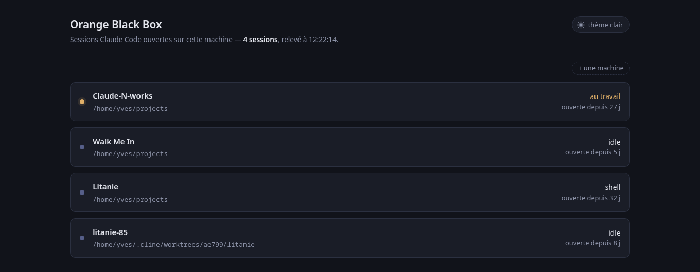
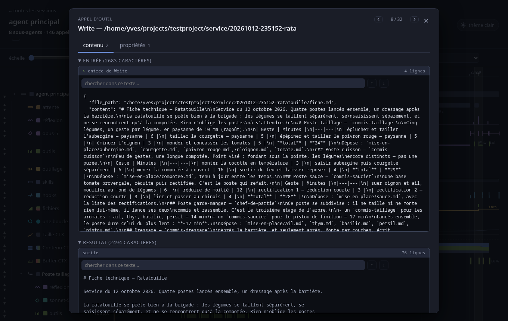
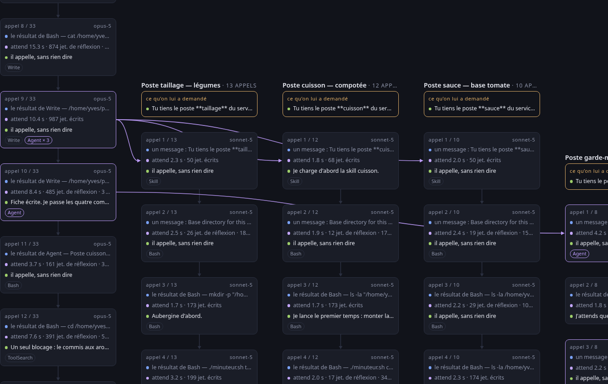

# 3 — Se servir de l'application

[← la documentation](LISEZ-MOI.md)

- [L'écran des sessions](#lécran-des-sessions)
- [Se déplacer dans la ligne du temps](#se-déplacer-dans-la-ligne-du-temps)
- [La règle du temps](#la-règle-du-temps)
- [Lire les couleurs](#lire-les-couleurs)
- [Les cartes](#les-cartes)
- [Chercher dans un texte](#chercher-dans-un-texte)
- [La chaîne des appels](#la-chaîne-des-appels--le-même-travail-sans-le-temps)
- [Le temps réel, et la pause](#le-temps-réel-et-la-pause)
- [Replier, ranger, masquer](#replier-ranger-masquer)
- [Les deux thèmes](#les-deux-thèmes)
- [Ce dont l'écran se souvient](#ce-dont-lécran-se-souvient)

## L'écran des sessions



Il liste les sessions Claude Code **réellement vivantes** : il lit
`~/.claude/sessions/*.json` et vérifie que le processus existe encore, car un fichier
survit à la session qu'il décrit. Un fichier mal formé, sans `sessionId`, ou dont le
processus est mort est ignoré sans bruit et compté à part.

Pour chaque session : son nom, son dossier de travail, son état, depuis quand elle est
ouverte, et le nombre de sous-agents déjà sur disque. La sélection affiche son identité
complète, le chemin de son transcript, et sa version de Claude Code.

La liste se tient à jour toute seule, par flux d'événements, sans rechargement.

Sélectionner une session ouvre sa fiche d'identité **en modale**, comme les cartes de
l'écran de session — les deux écrans parlent la même langue, et le fond ou la touche
d'échappement la referment. **Un bouton plein** y mène à la ligne du temps : c'est la seule
action de cet écran et l'unique raison d'avoir choisi une session — elle doit se voir comme
un bouton, et non comme un lien de plus au milieu d'une liste de champs. Mesuré : le texte
rend **7,4 : 1** sur le bouton en thème sombre et 5,7 : 1 en clair, et le bouton lui-même
6,7 : 1 contre la fiche.

Deux précautions, imposées par le fait que la liste se rafraîchit toutes les 500 ms.
L'ouverture est un **état à part de la sélection** : déduite de la session choisie, une
modale fermée se serait rouverte d'elle-même au relevé suivant — vérifié, elle reste
fermée sur deux relevés. Et **une session peut mourir pendant qu'on lit sa fiche** : la
modale garde alors ses champs, ceux du dernier relevé, et le dit en toutes lettres plutôt
que de se vider sous les yeux.

Le bouton **+ une machine** est décrit dans [la sonde](2-la-sonde.md).

## Se déplacer dans la ligne du temps

| Geste | Effet |
|---|---|
| **molette** | zoome **autour du curseur** : l'instant sous le pointeur y reste |
| **bouton gauche enfoncé + souris** | déplace la vue, horizontalement et verticalement |
| **curseur « échelle »** | même zoom, centré sur la vue |
| **clic** sur une marque | ouvre sa carte |
| **← →** carte ouverte | va au voisin |
| **Échap** | referme la carte |

Le zoom à la molette relève l'instant sous le curseur avant de changer d'échelle, puis
recale le défilement pour qu'il retombe au même endroit. Mesuré sur vingt crans consécutifs,
soit un facteur mille d'échelle : la dérive reste **sous le demi-pixel** et ne s'accumule
pas.

La plage de zoom va de « toute la session dans la fenêtre » jusqu'à **46 pixels par
seconde** sur un transcript de onze jours — assez pour séparer deux appels distants de
quelques dizaines de millisecondes. Deux bornes l'arrêtent : un pixel par milliseconde,
au-delà duquel il n'y a plus rien à gagner, et une largeur de dessin de 16 millions de
pixels. Cette seconde borne vient d'une mesure : le navigateur place correctement un
élément jusqu'à 20 millions de pixels, et **écrête à 33 554 428** — au-delà, la fin du
dessin se replie sur elle-même.

**On ne dessine que ce qui est visible**, élargi d'une marge, et on redessine en défilant.
Sans ce découpage, la règle seule produisait 140 000 traits et 70 000 étiquettes à fond de
zoom, soit deux secondes par redessin — inutilisable à la molette. Mesuré après :

| Échelle | Largeur | Éléments | Redessin |
|---|---|---|---|
| 0,1 px/min | 896 px | 5 960 | 50 ms |
| 1,8 px/s | 637 000 px | 1 144 | 14 ms |
| 45,8 px/s | 16 000 000 px | 823 | **11 ms** |

Et le contrôle qui compte : dix appels pris sur toute la durée des onze jours sont bien
dessinés quand on défile jusqu'à eux. Le découpage ne cache rien.

**Le repère d'une requête s'attrape.** Sa pastille fait 5,5 px de rayon, mais ce qu'on
clique est plus large que ce qu'on voit : une prise transparente double la cible, sur la
pastille comme le long du trait. Elle est **bornée à la demi-distance au repère voisin**,
parce qu'une prise fixe se volerait le clic d'à côté — mesuré sur une session de 76
requêtes vue en entier, l'écart médian entre deux repères est de **3 pixels**. Zoomé, le
rayon de prise atteint 13 px et plus aucune prise n'en chevauche une autre.

Un glissé de plus de quatre pixels n'ouvre pas de carte — sans quoi tout déplacement qui
part d'une barre en ouvrirait une. En deçà, c'est un clic et il agit normalement.

> Le glissé suit le pointeur par des écouteurs posés sur la fenêtre, et **non** par
> `setPointerCapture`. La capture paraissait l'outil fait pour ça — elle garde le glissé
> vivant quand le curseur sort du cadre — mais elle redirige aussi le clic qui suit vers
> l'élément capturant : la cible devenait `<div class="piste">` au lieu de la barre, et plus
> aucune carte ne s'ouvrait.

### Le repli des temps morts

La session `819d3fef` s'étale sur 264 heures pour 1710 appels, dont sept jours
d'inactivité : à l'échelle linéaire, tout le travail devient invisible. L'axe replie donc
les périodes vides, avec un seuil proportionnel à la durée de la session (un
quatre-centième, jamais moins d'une minute). Chaque repli est **annoncé et compté** —
« 23 temps morts repliés, 7,0 j élidée » — et la case à cocher le désactive. À l'écran,
c'est une bande verticale gris très clair qui traverse toute la hauteur, règle comprise :
l'axe du temps lui-même saute là. Rien n'est masqué en silence.

Un « temps mort » est un intervalle où **aucun événement n'est enregistré** : pas un appel
d'outil qui commence ou finit, pas un agent qui naît ou meurt, pas une requête. Classés sur
les deux grosses sessions, les 45 trous repliés se répartissent ainsi :

| Ce que c'était | Trous | Durée |
|---|---|---|
| Après un `Bash` — le tour s'achève et plus personne au clavier | 26 | 253 h |
| Après un `ScheduleWakeup` — une boucle qui dort entre deux tours | 7 | 98 h |
| Pendant un `AskUserQuestion` — l'agent attend une réponse d'Yves | 8 | 37 h |
| Après une notification ou un envoi de fichier | 4 | 22 h |

C'est donc **de l'attente**, sous trois formes. Et le contrôle qui compte : les seuls appels
d'outil plus longs que le seuil de repli sont des `AskUserQuestion` — c'est-à-dire de
l'attente eux-mêmes. **Aucun travail en cours n'est jamais replié.**

## La règle du temps

Une graduation en haut de la piste, avec un filet pâle qui descend sur les voies. Les
instants sont ronds en **heure locale**, pas en temps epoch, et le pas suit l'échelle en
privilégiant les repères qui se lisent vite — l'heure ronde, puis les dizaines de minutes
(:00, :10, :20…), puis les multiples de cinq, puis la minute. Le quart d'heure, la
demi-heure et les deux minutes sont écartés exprès. Mesuré du plus large au plus serré :

```
12 h  →  3 h  →  1 h  →  10 min  →  5 min  →  1 min  →  30 s  →  10 s  →  5 s
```

Elle se calcule **par segment actif**, et non sur toute la largeur : les temps morts étant
repliés, le temps n'avance pas au même rythme d'un bout à l'autre, et une graduation
régulière en pixels mentirait. Chaque segment porte en plus un repère daté à son départ,
car à grande échelle le pas retenu peut dépasser la durée d'un segment — la règle serait
alors muette. Une étiquette qui n'a pas la place n'est pas écrite ; son trait reste.

## Lire les couleurs

Rester sur une ligne de l'arbre — l'agent, le contexte, l'attente, les boucles — en donne
la légende complète : ce que chaque couleur signifie **dans cette voie-là**. Pour un agent,
l'état de la barre et la nature des marques d'outils ; pour le contexte, ce que le dégradé
mesure et quand il ne mesure rien ; pour l'attente, les trois formes ; pour les boucles,
les montants et les encoches.

C'est la **seule** légende. Un bandeau de treize pastilles occupait une ligne entière en
haut de l'écran, et il répondait moins bien : une même couleur ne dit pas la même chose
d'une voie à l'autre — l'ambre est une requête sur la piste, une question posée sur la voie
d'attente. La légende qui vaut est celle de la voie qu'on regarde.

## Les cartes



Cliquer un agent, un appel d'outil, une boucle, une requête ou une voie de contexte ouvre
sa carte — dans l'arbre comme dans la piste. Elle s'ouvre en **modale au milieu de
l'écran**, large de 62 rem au lieu des 31 d'un tiroir latéral : lire un contexte ou un long
résultat d'outil demande de la largeur. Le fond ou Échap la referment.

**Rien n'est tronqué.** La mesure a tranché : sur le plus gros transcript de la machine,
37 Mo et 1717 appels d'outils, tout garder porte le modèle de 4,7 à 8,0 Mo — tandis qu'une
limite à 700 caractères amputait **44 % des entrées d'outils et 32 % de leurs résultats**,
c'est-à-dire précisément ce qu'on vient lire. Le coût mesuré côté navigateur : 22 ms pour
analyser les 7,9 Mo de JSON, 2 s pour charger la page. Le plus gros contenu observé fait
29 143 caractères, aucun ne dépasse cent mille.

**La carte d'un appel d'outil se lit comme une console.** L'entrée et le résultat sont
rendus en terminal — fond sombre dans les deux thèmes, bandeau d'invite, et la sortie dans
un gris plus doux que la commande. Un `Bash` porte l'invite `$` et le mot « commande » ;
les autres outils portent `›`, parce que leur entrée est du JSON et non une ligne de
commande, et lui donner une invite de shell serait un mensonge de forme. Un résultat en
échec passe en rose. Chaque bandeau donne aussi le nombre de lignes.

> ⚠️ **Le contenu du bloc reste exact** : l'invite vit dans le bandeau, jamais dans le
> texte. Sans cela un copier-coller rapporterait une commande fausse, et le compte de
> caractères mentirait.

Le contraste a été mesuré : la commande rend **13,8 : 1** sur le fond de la console, la
sortie 8,6, un échec 7,3. Et la bordure — elle seule — dépend du thème : sur une fiche
sombre, la console ne rend que **1,15 : 1** contre son fond, et descendre jusqu'au noir pur
ne la porte qu'à 1,25. On ne sépare pas deux surfaces sombres par le ton ; c'est la bordure
qui le fait, à **2,05 : 1**.

Les blocs d'entrée et de résultat sont **ouverts d'emblée** : c'est le contenu qu'on vient
lire. Chacun garde sa hauteur bornée et son propre ascenseur. Seules les instructions
chargées d'un skill restent repliées : des milliers de caractères, et ce n'est pas ce qu'on
regarde en premier.

Un appel de skill a sa propre carte, avec la consigne qui lui a été donnée **et les
instructions réellement chargées** — l'appel dit ce qu'on a demandé, l'attachement
`invoked_skills` dit ce qui a été injecté : 8 778 caractères pour le skill `loop`.

### Les deux onglets

Une carte porte deux choses de nature différente : **ce qui a été écrit** — la réponse du
modèle, l'entrée et le résultat d'un outil, la définition d'un skill, le contexte envoyé —
et **ce qui décrit l'appel** : ses champs, ses durées, ses jauges. Elles se disputaient la
même colonne, si bien qu'il fallait faire défiler une liste de vingt lignes pour atteindre
la phrase qu'on venait lire. Deux onglets les séparent, *contenu* et *propriétés*, chacun
annonçant combien de blocs il tient.

**Une carte qui n'a qu'une sorte n'a pas d'onglets** — celle d'une requête, celle d'un tour.
Deux onglets dont un vide coûteraient un clic pour ne rien montrer.

**L'onglet choisi est retenu**, et vaut pour toutes les cartes et toutes les sessions : on
vient lire une carte pour une raison, et cette raison ne change pas d'un appel au suivant.
Choisir *propriétés* sur un appel d'outil ouvre la carte suivante — modèle, skill, hook —
sur ses propriétés. C'est un goût, au même titre que le thème.

Les flèches gauche et droite passent d'un onglet à l'autre, et la tabulation sort des
onglets plutôt que de les traverser. Les blocs gardent leur état d'un onglet à l'autre : un
contexte déjà chargé — 13 565 caractères dans la mesure — reste chargé et déplié après un
aller-retour.

**La distinction se lit sur la balise, pas sur une liste à tenir à jour** : est un contenu
ce qui est un bloc dépliable, et rien d'autre. Une carte nouvelle se range donc d'elle-même
du bon côté.

### Passer au voisin sans refermer

On lit rarement une carte seule : on compare l'appel d'avant, celui d'après, on suit une
suite d'échecs. Refermer et viser la marque suivante au pixel est un geste coûteux.

Deux flèches en haut de la carte, avant la croix, mènent au voisin, avec le rang —
**« 8 / 32 »**. Les touches ← et → font la même chose. En butée, la flèche s'éteint.

**C'est la carte qui dit ce qu'est un voisin.** Pour un appel d'outil, ce sont les autres
appels du même agent dans l'ordre du temps ; pour un appel au modèle, les autres appels *au
même modèle*, puisque c'est une voie par modèle ; pour un hook, un shell, un skill, un
changement d'outillage, une consigne ou un agent, la liste correspondante. Une carte dont
l'élément n'appartient à aucune liste — ou dont la liste n'a qu'un élément — n'a pas de
flèches.

**La flèche du clavier reste aux onglets quand c'est un onglet qui a le curseur**, et aux
champs de saisie, où elle déplace le curseur dans le texte.

### Le contexte d'un appel

**La carte d'un appel ne montre que CET appel.** Elle donnait tout le contexte accumulé —
425 éléments sur une session un peu longue — et les quatre qui concernaient l'appel qu'on
regardait s'y noyaient. Elle montre maintenant ce que l'appel a **apporté** : ce qui est
entré depuis l'appel précédent, la réflexion, ce qui est sorti. Le compte entier reste dit
en une ligne — « 4 éléments pour cet appel, 1 170 caractères — le contexte entier en
portait 75 et 50 267 » — pour qu'on ne croie pas que le modèle n'a reçu que cela.

**Rien n'a été perdu, mais deux choses ont changé de place.** Vérifié : sur la session
d'exemple, les 137 éléments du contexte entier apparaissent chacun dans exactement un
appel — aucun n'est devenu inatteignable. Ce qui a changé, ce sont les usages :

- **chercher dans tout le contexte** ne marchait plus que sur un appel. Une bascule
  *cet appel* / *tout le contexte* est posée à côté du compte : elle élargit la liste, les
  filtres et la recherche à l'ensemble. Mesuré : 4 éléments et 3 genres d'un côté,
  75 éléments et 6 genres de l'autre, et « ratatouille » retrouve ses 21 éléments.
- **la mise en place** — la consigne, le listing des skills, les instructions des serveurs
  MCP, le rappel de jetons — n'était plus visible que sur le tout premier appel. Elle est
  une propriété de l'**agent** et non d'un de ses appels : la carte d'un agent la porte
  maintenant, dépliable, avec la même recherche et les mêmes filtres. Elle pèse
  **12 314 caractères en moyenne** sur dix sessions mesurées, dont le listing des skills
  fait l'essentiel.

> Sa borne est l'instant où le modèle commence à répondre, **moins une milliseconde**.
> `appel` est trop bas — mesuré, il précède les pièces jointes elles-mêmes et rendait la
> liste vide — et `debut` ferait entrer la première réflexion, qui est déjà du travail.
>
> La borne haute est la **fin** de l'appel et non son départ. Mesuré : bornée au départ,
> comme le faisait la première version, la liste ne contenait jamais ce que le modèle avait
> dit ni ce qu'il avait demandé — elle ressortait **vide**.

**Le lecteur de contexte s'ouvre d'emblée.** Replié, il était souvent la seule chose de
l'onglet *contenu* — sur un appel qui se termine par un outil, le modèle n'a rien dit — et
l'onglet paraissait vide. La lecture reste asynchrone : la carte s'ouvre en 3 ms, le bloc
affiche « lecture du contexte… », puis se remplit. Mesuré sur la plus grosse session de la
machine, 2 730 appels sur onze jours : 780 ms et 712 ko.

### Le contexte raconte une histoire, et elle se lit

Le contenu d'un contexte arrivait **à plat** : soixante-quinze lignes qui se ressemblaient
toutes, où il fallait lire chaque titre pour savoir où on en était. Or la trace a un rythme,
et il se mesure — **réflexion → appel → résultat → rappel de jetons**, répété, ponctué par
ce que le modèle dit. La liste le rend maintenant visible.

**Un geste** — ce que la machine fait d'un bloc : elle réfléchit, elle appelle, elle reçoit —
est lié par un filet, et son en-tête donne l'outil, l'heure et ce qu'il pèse. Un nouveau
geste commence à une réflexion, ou à un appel qui suit un résultat.

**Plusieurs appels dans un même geste ne sont pas une suite** : ils sont partis *ensemble*,
dans un seul message. Le filet passe alors au bleu des appels et l'en-tête le dit — « 4
appels lancés ensemble — Agent ». La liste à plat donnait quatre lignes identiques sans
rien dire de leur simultanéité, qui est pourtant tout ce qui fait gagner du temps.

**Les moments** se détachent par un filet de leur couleur : *la consigne* d'Yves, *ce que le
modèle a dit* — avec la réflexion qui y mène, car ce n'est pas un geste orphelin mais la
pensée qui aboutit —, *la reprise après compactage*, et *la mise en place* : ce qui était là
avant qu'on demande quoi que ce soit. Celle-ci se replie, parce qu'on ne vient presque jamais
la lire et que c'est elle qui pèse le plus.

**Le découpage ne jette rien et n'invente rien, il regroupe** : vérifié sur 41 contextes et
6 185 éléments, aucun élément perdu. La recherche et les filtres s'appliquent avant lui, si
bien qu'un contexte filtré se regroupe comme un contexte entier.

## Chercher dans un texte

Tout bloc de texte de plus de quatre cents caractères porte une barre de recherche :
surlignage de toutes les occurrences, compte, et saut de l'une à l'autre par les flèches ou
par Entrée. La lecture du contexte en a une qui porte sur **tout le contexte à la fois** :
elle réduit la liste aux éléments contenant le terme et les ouvre déjà surlignés — par
exemple 55 éléments sur 428 pour un mot donné.

Les requêtes d'Yves — et elles seules — traversent les voies en repères verticaux : la
saisie interactive, reconnue à son `origin.kind` valant `human`, **et** la consigne d'une
session lancée non interactivement, qui n'a pas d'`origin` du tout mais un `promptSource`.

## La chaîne des appels — le même travail, sans le temps



La ligne du temps répond à « quand », et elle le fait bien ; elle répond mal à « quoi a mené
à quoi », parce qu'un appel de trois secondes et un de trois minutes n'y ont pas la même
largeur et qu'on ne compare plus rien. La chaîne répond à cela, et à rien d'autre : elle
**n'a pas de temps du tout**.

Une colonne par agent, une boîte par appel au modèle, et dans chaque boîte les trois
moments : **ce qui entre**, **ce qui se passe**, **ce qui sort**. Un appel qui lance un
agent porte sa pastille et une flèche part vers la colonne du nouveau-né. Cliquer une boîte
ouvre la même carte que sur la ligne du temps.

On y arrive par le bouton posé à côté d'une requête, sur la ligne du temps.

## Le temps réel, et la pause

Une session vivante se suit en direct : les agents apparaissent dès leur première ligne,
sans attendre leur fin, les appels d'outils s'ajoutent, les rails de boucle s'allongent, et
un repère « maintenant » glisse vers la droite même quand rien ne se produit. L'en-tête
affiche « en direct » tant que le processus répond.

La lecture est **incrémentale** : on garde par fichier la position déjà lue et l'état déjà
dépouillé, et chaque passage ne lit que ce qui s'est ajouté. Le coût ne dépend donc pas de
la taille du transcript — relire les 37 Mo à chaque ligne écrite aurait coûté 610 ms à
chaque fois.

Deux précautions, imposées par le fait qu'on lit un fichier pendant qu'il s'écrit : une
ligne peut être incomplète, donc on ne traite que jusqu'au dernier saut de ligne et on
garde le reste ; et le répertoire `subagents/` n'existe pas tant qu'aucun sous-agent n'a
été lancé, donc on le cherche à chaque passage et pas une seule fois à l'ouverture.

### Mettre le suivi en pause

Une session vivante se redessine à chaque ligne écrite, et le repère *maintenant* glisse
chaque seconde. C'est ce qu'on veut en la regardant travailler ; c'est insupportable quand
on cherche à lire quelque chose de précis, parce que l'écran bouge sous les doigts.

Un bouton **pause** paraît à côté de la mention « en direct », et seulement là : sur une
session finie, rien ne bouge et il n'y aurait rien à arrêter.

**En pause, rien n'est perdu.** Ce qui arrive est mis de côté, et le bouton dit combien de
fois la session a avancé pendant ce temps — « 3 avancées en attente ». Reprendre applique
le **dernier** état connu d'un coup : seul le dernier décrit la session telle qu'elle est.
C'est la différence entre une pause et une déconnexion : on ne rate rien, on le regarde
plus tard.

Vérifié sur une session réellement vivante : **4 redessins** en trois secondes et demie
quand le suivi court, **zéro** en pause, et 4 de nouveau après reprise. L'écran est resté
figé à 1 003 appels d'outil pendant que la session en écrivait quatre de plus, qui sont
tous apparus d'un coup à la reprise.

## Replier, ranger, masquer

### Replier l'arbre

Chaque ligne d'agent porte un chevron. Le replier ferme **tout ce qui est sous lui** : ses
propres voies annexes comme ses sous-agents et leur descendance. Un agent replié tient donc
en une seule ligne, qui dit combien d'agents elle dissimule. Sur l'arbre à neuf agents du
kit cuisine : 45 lignes tout déplié, 9 en repliant la profondeur 1, **une seule** en
repliant la racine.

L'indentation se fait au pixel, avec un filet vertical par niveau, et les voies annexes
d'un agent s'indentent d'un cran sous lui.

### Survoler une ligne entière

Le survol n'allumait que le **titre**, à gauche. Il fallait donc suivre la ligne des yeux
sur toute la largeur de la piste sans rien pour la tenir — et sur un écran où les voies se
comptent par dizaines, on perd la sienne.

Une ligne s'allume maintenant **d'un bord à l'autre**, et dans les deux sens : survoler le
titre allume la piste, survoler la piste allume le titre.

**Chaque voie vit dans son propre groupe**, dont la bande de survol est le premier enfant :
elle passe donc derrière les marques, qui gardent leurs clics et leurs infobulles — vérifié,
un clic au milieu d'un appel d'outil ouvre toujours sa carte. Et c'est le **groupe** qui
écoute, non la bande : les marques en sont des descendants, si bien que passer de l'une à
l'autre ne déclenche aucune sortie et que rien ne scintille.

Coût mesuré sur une session à 97 voies, trois tours et quatre niveaux de zoom : le redessin
passe de **63 à 70 ms** de médiane pour 194 éléments de plus.

### Ranger les voies

Deux flèches en tête de chaque ligne échangent la voie avec sa voisine, vers le haut ou
vers le bas. Cela sert à **rapprocher deux voies qu'on veut comparer** — mettre les appels
au modèle juste sous les appels d'outils, par exemple, pour voir ce qui déclenche quoi.

Tant qu'on n'y touche pas, l'ordre naturel s'applique, et une voie qui apparaît en cours de
route — un sous-agent qui vient de naître — se place d'elle-même au bon endroit. Dès qu'on
a rangé, les nouvelles voies se posent à la fin plutôt que de bousculer ce qui est en place.

Les flèches sont posées en gris clair à mi-opacité, et non en gris sombre : mesuré au pixel,
elles passent d'une luminance de 60 à 127 sur un fond à 21, soit 2,7 fois plus de contraste.
Une commande qu'on ne voit pas est une commande qui n'existe pas.

### Choisir les voies affichées

Un menu « voies » liste les voies annexes — contexte, attente, boucles — avec une case par
genre et le nombre de voies que la session en produit. Décocher retire la voie partout, sur
tous les agents à la fois : sur un arbre de neuf agents, les voies de contexte doublent le
nombre de lignes. Une voie que la session ne produit pas reste listée mais grisée, avec
« aucune » : mieux vaut dire qu'elle n'existe pas ici que de la faire disparaître du menu.

Les voies d'agents, elles, ne se masquent pas : ce sont elles qu'on vient voir.

Au bas du menu, **tout réafficher et remettre l'ordre** défait le tout.

## Les deux thèmes

Un bouton en haut à droite, sur les deux écrans, bascule entre le **thème sombre** — celui
d'origine, qui reste le défaut — et un **thème clair**. Il annonce où l'on va, pas où l'on
est : en sombre il propose le clair. Le choix est retenu avec le reste des réglages, vaut
pour toute l'application, et il est appliqué **avant le premier affichage** — une page
choisie en clair ne paraît jamais sombre le temps d'une image.

**Le thème clair n'est pas une inversion.** Ce sont les mêmes familles de teintes — le vert
reste l'outil, le cyan la boucle, l'ambre la requête — re-marchées pour un fond clair, puis
validées :

| Contrôle, sur fond `#eceef3` | Mesure |
|---|---|
| bande de clarté | les six teintes dedans |
| plancher de chroma | les six au-dessus |
| séparation en déficience de vision | pire paire adjacente **ΔE 6,8** (vert↔ambre) |
| vision normale | pire paire adjacente **ΔE 16,7**, plancher à 15 |
| contraste sur le fond | les six **au-dessus de 3:1** |

La séparation à 6,8 est dans la bande tolérée, et elle n'est tolérable que parce que la
couleur **ne porte jamais seule** l'identité ici : chaque voie est nommée dans l'arbre,
chaque marque a son infobulle, chaque pastille de légende porte son mot.

> ⚠️ **Et la palette sombre, elle, ne passerait pas ce contrôle** : vert et ambre y sont à
> **ΔE 0,8** en deutéranopie et à **11,7** en vision normale, sous le plancher. Elle n'a pas
> été touchée — changer l'identité de l'application n'avait pas été demandé — mais le fait
> est mesuré et consigné ici.

Deux valeurs ont été choisies par la mesure plutôt qu'à l'œil. Le bleu « en cours » est
`#2563c9` et non `#3b82f6` : une barre d'agent est peinte à 85 % d'opacité, et le bleu plus
clair n'y rendait que **2,64:1** contre le fond, contre 3,75:1 pour celui-ci. Le gris de
l'attente est passé de 2,65:1 à **3,32:1**. En revanche la barre d'un agent **terminé** n'a
pas été retouchée : elle paraissait délavée, mais la mesure dit **1,80:1 en clair contre
1,53 en sombre** — elle est en fait meilleure, et l'œil s'était trompé.

Côté code, les **94 couleurs écrites en dur** dans `session.html` sont remontées en
variables : le thème bascule donc **sans redessiner**, puisque les attributs SVG lisent
`var(…)` et que le navigateur les recalcule seul. Une seule exception, l'échelle du Buffer
CTX, qui s'interpole en JS entre deux paliers : elle relit la palette à chaque dessin.

## Ce dont l'écran se souvient

Ce qu'on dispose soi-même survit au rechargement. Sans cela, chaque retour sur une session
redemande le même travail : remasquer les voies qu'on ne regarde pas, remettre côte à côte
celles qu'on compare, replier les sous-agents qu'on a déjà lus.

Deux portées, parce que ce ne sont pas les mêmes choses :

| | |
|---|---|
| **le thème** | pour toute l'application, les deux écrans compris — c'est un goût |
| **les voies affichées** | pour **toutes** les sessions — c'est un goût, pas un détail de telle trace |
| **l'ordre des lignes et les agents repliés** | pour **cette** session seulement : les identifiants d'agents ne veulent rien dire ailleurs |

Tout tient dans une seule entrée de `localStorage`, et les quarante sessions vues le plus
récemment seulement : au-delà, les plus anciennes s'effacent, sans quoi le stockage
grossirait sans fin. Mesuré avec soixante sessions en mémoire : quarante retenues, la
courante toujours gardée, 3,6 ko au total.

Si le navigateur refuse d'écrire — navigation privée, stockage plein — l'écran ne s'arrête
pas : il se passe de mémoire et continue.

---

[Suivant : les voies, une par une →](4-les-voies.md)
