# 4 — Les voies, une par une

[← la documentation](LISEZ-MOI.md)

Une ligne du temps est faite de **voies** empilées : une par agent, et sous chaque agent
les voies annexes qui le décrivent. Chacune répond à une question, et une seule. Cette page
les prend l'une après l'autre, en image.

Les captures viennent de deux sessions réelles : **`819d3fef`** — onze jours, 1 726 appels
d'outil, 3 746 hooks, 98 shells, 10 boucles — et la session du **[kit
cuisine](../exemples/cuisine/LISEZ-MOI.md)**, courte et à neuf agents, quand il faut montrer
un arbre.

**L'ordre naturel suit une lecture.** D'abord le **rythme** — quand la machine a travaillé,
quand elle a attendu, quand elle a réfléchi, à quel modèle elle a parlé. Puis **ce qu'elle
a fait** — ses outils, ses shells, l'outillage qui change, les skills qu'elle charge, les
hooks qui l'encadrent, les fichiers qu'elle touche, les boucles qui la répètent. Puis le
**contexte**, ses trois voies ensemble à la fin.

| | | |
|---|---|---|
| [Agents et sous-agents](#agents-et-sous-agents) | [travail](#travail) | [attente](#attente) |
| [réflexion](#réflexion) | [le modèle](#le-modèle) | [outils](#outils) |
| [shells de fond](#shells-de-fond) | [outillage](#outillage) | [skills](#skills) |
| [hooks](#hooks) | [fichiers](#fichiers) | [boucles](#boucles) |
| [Taille CTX](#taille-ctx) | [Contenu CTX](#contenu-ctx) | [Buffer CTX](#buffer-ctx) |

### Les pictogrammes

Chaque voie porte un **pictogramme dessiné** dans sa couleur, et chacun est une miniature
de ce que la voie trace : une barre pour l'agent, la même barre avec son coude de
rattachement pour un sous-agent, des barres inégales pour les outils, des traits de part et
d'autre d'une ligne pour les hooks, une bande à bord gauche épais pour les skills, un
escalier pour les fichiers, une flèche qui revient pour les boucles, une courbe qui monte
pour la taille du contexte, des bandes empilées pour son contenu.

> **Ils étaient des caractères, et sept des quinze sortaient en carré vide.** Mesuré par
> deux instruments concordants : `fc-list` ne trouve aucune police installée couvrant
> ⊡ (travail), ⊞ (outils), ∿ (réflexion), ⊠ (outillage), ⊝ (attente), ⊟ (fichiers) et
> ⟳ (boucles) ; et l'empreinte au pixel de ces sept glyphes est identique à celle d'un tofu
> connu. La découverte est venue d'un contrôle de routine — vérifier que le nouveau
> pictogramme des skills n'en était pas un — ce qui a révélé que presque la moitié de la
> signalétique n'existait pas à l'écran depuis le début.
>
> Chercher d'autres caractères n'aurait fait que **déplacer le pari** sur les polices du
> poste ; un tracé ne dépend de rien. Les quinze sont désormais du SVG en `currentColor`,
> et le pictogramme le plus faible rend 4,32 : 1 contre le fond, au-dessus du seuil de
> 3 : 1 exigé d'un objet graphique.

---

## Agents et sous-agents

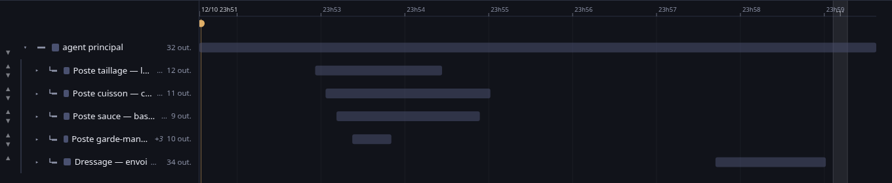

*Kit cuisine : l'agent racine et ses cinq sous-agents directs, repliés.*

Une voie par agent, l'agent racine en haut, chaque sous-agent sous son parent. La barre
d'un agent commence quand son parent l'a lancé ; terminée, elle se grise ; encore en cours,
elle reste en pointillés, ouverte à droite. Les quatre états mesurés sont distingués :
**en cours, terminé, interrompu, fin inconnue**.

Sa carte donne son état, son type, sa profondeur, qui l'a lancé, ses instants, son modèle,
son effort, ses jetons, les outils qu'il a **employés** comptés par nom, son entrée et sa
sortie, et sa **mise en place** — tout ce qui était dans son contexte avant qu'on lui
demande quoi que ce soit. Un agent à la fin inconnue le dit en toutes lettres.

Ces voies-là ne se masquent pas : ce sont elles qu'on vient voir.

---

## travail

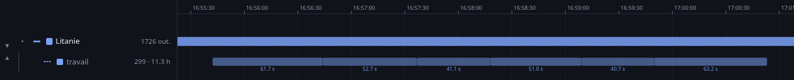

*`819d3fef`, six tours consécutifs — 61,7 s, 52,7 s, 41,1 s, 51,0 s, 40,7 s, 63,2 s.*

Un **tour** va de ce qui réveille l'agent — une requête d'Yves, un réveil de boucle, la fin
d'une tâche d'arrière-plan — jusqu'à ce qu'il rende la main. Claude Code en écrit lui-même
la durée à sa fin, dans un enregistrement `system/turn_duration`. C'est donc la **seule
mesure exacte** du temps de travail, et non une estimation tirée des événements.

La voie se place juste sous l'agent : tout le reste — outils, appels au modèle — se loge
dedans, et ce qui sépare deux barres n'est pas du travail plus discret, c'est de l'attente.
L'intensité d'une barre suit le nombre d'appels qu'elle contient.

**Le chiffre que tout le reste laissait deviner** : sur `819d3fef`, 299 tours,
**11,3 heures de travail cumulé sur 11,4 jours** — soit **4,1 %**. Les tours ne se
chevauchent jamais. La médiane d'un tour est de 66 secondes, le plus long dure 84 minutes.

Cliquer un tour en donne le détail : combien d'appels d'outils et de requêtes au modèle il
contient, et la part de sa durée passée dans les outils et chez le modèle. Exemple relevé :
un tour de 10 minutes, 27 appels `Bash`, 28 requêtes au modèle — 20 % du temps dans les
outils, 51 % chez le modèle.

> La voie s'appelait *tours* jusqu'au 15 octobre 2026 ; la carte, elle, disait déjà
> « travail cumulé ». **Le tour reste l'unité** — la voie se mesure en tours, elle s'appelle
> travail.

---

## attente

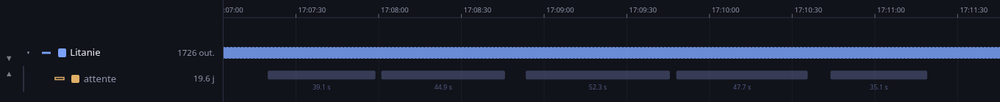

*`819d3fef` : cinq inoccupations consécutives, de 35 à 52 secondes, durée écrite sous
chaque barre.*

Les moments où le système **ne travaille pas mais patiente**. *travail* et *attente* sont
volontairement voisines : elles partagent le même temps et se lisent en vis-à-vis — ce qui
n'est pas dans l'une est dans l'autre.

Trois formes, chacune avec sa couleur :

| | Ce que c'est |
|---|---|
| **ambre** | une `AskUserQuestion` posée et pas encore répondue |
| **cyan** | une boucle qui dort entre deux tours, après un `ScheduleWakeup` |
| **gris** | le tour s'est achevé et personne n'a repris la main |

Une attente est un intervalle de plus de trente secondes **sans aucun événement**, ou bien
une question restée sans réponse. Une attente en cours — la session tourne, personne ne
répond — reste ouverte à droite, en pointillés. La **durée est écrite sous chaque barre**
dès qu'elle y tient ; en deçà, l'étiquette se chevaucherait avec ses voisines et seul le
survol la donne.

**Les pauses de réflexion de l'agent n'en sont pas.** Ses propres messages comptent comme
des événements, sinon le temps qu'il passe à réfléchir entre deux appels ressemblerait à de
l'attente. Mesuré : les compter élimine 59 fausses attentes sur une session et 106 sur une
autre, pour seulement une heure et demie de différence — c'étaient bien des pauses courtes.

Sur `819d3fef` : **10,9 jours d'attente sur 11,1 jours** — dont 6,9 j de sommeil de boucle,
3,1 j d'inoccupation et 21,6 h de questions posées.

---

## réflexion

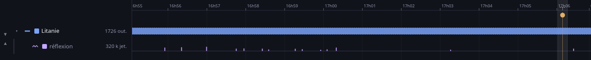

*`819d3fef`, une vingtaine d'appels : les barres hautes sont les réflexions longues, les
trous sont les appels où le modèle a répondu sans réfléchir.*

Une barre par appel où le modèle a réfléchi avant de répondre, de hauteur proportionnelle
au nombre de jetons de réflexion — **à l'échelle de la racine**, parce que la médiane est à
248 jetons et le pic à 3 475 : une échelle linéaire écraserait les quatre cinquièmes des
barres contre la ligne de base. L'absence de barre est un signal aussi.

Sur `819d3fef` : **886 appels sur 2 011 comportent une réflexion** (44 %), pour
319 699 jetons — soit 18 % de tout ce que le modèle a produit. Et un contraste que la carte
donne : il réfléchit **359 jetons en moyenne avant d'appeler un outil**, mais **517 avant de
seulement parler**.

> Le contenu de la réflexion n'est pas conservé par le transcript, seule sa signature l'est.
> On sait donc qu'elle a eu lieu et ce qu'elle a coûté, **jamais ce qu'elle disait**.

---

## le modèle

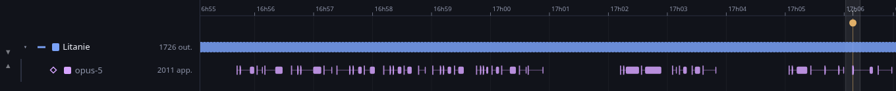

*`819d3fef` : une voie `opus-5`, 2 011 appels. Trait vertical = l'appel, ligne fine =
l'attente, rectangle plein = la réponse.*

Une voie par modèle réellement appelé, sous l'agent qui l'appelle. Chaque appel s'y lit en
trois temps : un trait vertical à l'instant de l'**appel**, une ligne fine pour l'**attente
avant la réponse**, puis un rectangle plein pour la **réponse**, du premier bloc au
dernier. Le décalage entre le trait et le rectangle est la latence.

Mesuré sur `819d3fef`, 2 001 appels à `claude-opus-5` : attente avant réponse de **7,9 s en
moyenne**, réponse de **6,4 s**. La répartition des attentes : 1 086 sous 5 s, 870 entre 5 et
30 s, 44 entre 30 s et 2 min, et **une seule** au-delà.

Cliquer un appel ouvre sa carte : **ce qui l'a déclenché** — une requête d'Yves, le
résultat d'un outil avec sa commande, la fin d'une tâche d'arrière-plan, le réveil d'une
boucle — les outils qu'il a appelés, et **ce que le modèle a dit**. La carte donne aussi
les totaux du modèle sur toute la session.

### Le cache, sur la carte d'un appel

C'est le chiffre qui compte le plus dans une longue session. Tout le contexte est renvoyé au
modèle **à chaque appel** : sans cache, il serait retraité chaque fois. L'entrée se
décompose donc en trois :

| | |
|---|---|
| **lus du cache** | déjà vus, non retraités — c'est eux qui rendent une longue session tenable |
| **écrits au cache** | ce qui vient d'être ajouté, payé une fois pour être relu ensuite |
| **payés au prix fort** | ce qui n'a pas été mis en cache du tout |

Une **jauge rouge → vert** porte la part réellement servie par le cache, pour l'appel
regardé et pour l'ensemble des appels du modèle. Sur `819d3fef` : **98,4 %** sur
973 831 462 jetons d'entrée au total. L'appel le moins bien servi est à 0 % — c'est le tout
premier de la session — et la médiane est à 99,7 %.

**Ce qu'on mesure et ce qu'on ne mesure pas**, dit aussi sur la carte. L'« appel » est le
dernier événement écrit avant la réponse : une requête d'Yves, un résultat d'outil, ou le
réveil d'une boucle — ce dernier compte, sans quoi la latence d'un tour de boucle
engloberait tout le sommeil. Le « début de réponse » est l'instant où le premier bloc a été
écrit, pas celui du premier jeton : un long bloc de réflexion repousse donc ce début. Et
**45 % des appels n'ont pas de durée de réponse mesurable** — leur réponse tenait en un
seul bloc, donc début et fin se confondent.

---

## outils

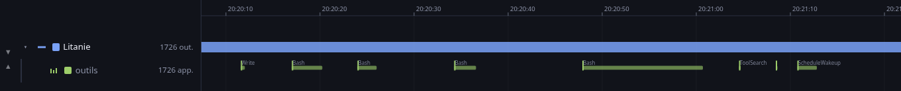

*`819d3fef`, une minute : `Write`, des `Bash`, `ToolSearch`, `ScheduleWakeup` — le nom
s'écrit au-dessus de la barre dès qu'il y a la place.*

Les appels d'outils ont **leur propre voie**, juste sous celle de l'agent. Ils étaient
auparavant posés sur la barre de l'agent, qu'ils recouvraient : un appel long — un appel
d'agent, une question à l'utilisateur — masquait l'agent lui-même. Chacun y figure à son
instant : un trait net au départ, une bande de couleur pour la durée. Un appel d'agent et
un appel en échec ont leur couleur.

**Deux appels peuvent partir ensemble, et se recouvraient.** Un message porte parfois
plusieurs `tool_use`, qui s'exécutent de front : sur une seule ligne, le second était
dessiné par-dessus le premier — invisible et incliquable. Mesuré sur **17 142 appels** :
36 % des agents en ont au moins deux qui se chevauchent, **580 appels étaient cachés sous
un autre**, et l'on monte jusqu'à quatre à la fois. Ils s'empilent maintenant sur des
rangées, et la voie grandit quand il le faut — 60 px pour quatre de front. La place se
décide **dans le temps et non en pixels**, pour que la hauteur soit stable d'un zoom à
l'autre.

Quand il n'y a qu'une rangée — **121 agents sur 190** — la géométrie est inchangée au
dixième de pixel. Vérifié en servant l'ancienne version en parallèle : sept voies sur neuf
identiques, une à 0,1 px près, et seule celle qui avait besoin de rangées a changé.

**Le nom de l'outil s'écrit au-dessus de la barre** dès qu'il y a la place. Celle-ci se
mesure jusqu'au **prochain appel**, pas jusqu'au bout de la barre : une étiquette a le droit
de déborder sur le silence qui suit, et c'est ce qui la fait apparaître sur un appel bref
suivi d'une pause. Bornée ainsi, elle ne peut jamais mordre sur la suivante — vérifié à
trois niveaux de zoom, **zéro chevauchement** par voie. Elle rend 3,76 : 1 contre le fond :
discrète, pas illisible.

### Un appel refusé n'est pas un appel qui échoue

Un refus veut dire que **l'outil n'a pas tourné du tout** — ce n'est pas la même chose
qu'un échec, où il a tourné et mal fini. La trace le dit en clair, par un champ que
l'application ne lisait pas, et **146 refus du corpus étaient donc montrés comme de simples
échecs** : 106 où Yves a répondu non, 20 par une règle de permission, 20 par le classifieur
du mode automatique.

Sur la voie, leur bande de durée est **creuse** : le contour dit « il y a eu un geste ici »,
le vide dit « il n'a rien produit ». La carte donne le genre du refus et sa **raison, telle
quelle**.

> ⚠️ **Un refus de hook ne se distingue pas d'un refus de règle** : les deux portent
> `permission-rule`, et aucun champ ne les sépare. Ce qui les sépare est la raison — une
> règle de Claude Code rend toujours la même phrase, un hook rend la sienne. La carte dit
> donc « la raison n'est pas celle que rend une règle », et se garde de nommer l'auteur.

### Les échecs et leurs reprises

Un appel en échec est rose, et **un arc le relie à l'appel qui le rattrape**, la pointe sur
la reprise. Le survol dit de quelle sorte de reprise il s'agit.

La forme de la signalétique vient d'une mesure, pas d'une intuition. Sur les **297 échecs**
de l'ensemble des transcrits, 78 % sont suivis d'un appel **du même outil** — mais presque
jamais à l'identique : seulement 5 cas de relance telle quelle, contre une large majorité
d'entrées corrigées. Le geste à rendre visible n'est donc pas « il réessaie », c'est « il
corrige et relance ». Sur `819d3fef` : 28 échecs, dont **23 repris avec une entrée
corrigée** et 5 abandonnés au profit d'autre chose.

---

## shells de fond

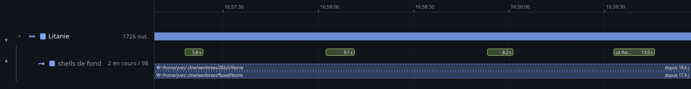

*`819d3fef` : quatre shells rendus (5,8 s, 9,1 s, 8,2 s, 13,0 s) et deux qui courent encore
depuis 18,6 et 17,9 jours, en pointillés sur toute la largeur.*

Ce que l'agent a lancé puis **laissé courir** pendant qu'il faisait autre chose. Une barre
par tâche, de son lancement à son compte rendu, nichée sous l'agent qui l'a lancée — comme
l'est un sous-agent, parce que c'est la même idée : un travail délégué qui a sa propre
durée et son propre sort. La couleur dit l'état : **verte** si elle a rendu, **rose** si
elle a échoué, **ambre** si on l'a arrêtée, **bleue et pointillée** si elle n'a jamais rendu
compte. Les traits verticaux sont les gestes portés **sur** la tâche pendant qu'elle court —
une consultation de sa sortie, son arrêt.

**Rien de tout cela n'était montré**, et le cycle de vie est pourtant entièrement dans la
trace — simplement éparpillé sur quatre formes, dont trois pour la seule fin. Mesuré :
508 lancements sur la machine, 501 qui annoncent leur identifiant, et sur une session de
131 tâches **129 fins retrouvées** — contre 66 quand on ne lisait qu'une des trois formes.
Sur l'ensemble du corpus, des 1 451 notifications de fin, **1 373 désignent une tâche** et
78 un agent : les premières étaient lues puis jetées.

**Elles s'empilent sur des rangées.** Toutes sur une seule ligne, les 131 shells d'une
session de onze jours ne faisaient qu'une bande bleue continue d'un bord à l'autre. Chacun
reprend maintenant la première rangée libre. Mesuré : au plus **cinq shells à la fois**.

**C'est la seule voie qui grandit.** Sa hauteur suit le nombre de shells qu'elle porte de
front : ordinaire quand il n'y en a qu'un ou deux — **41 agents sur 52** —, et jusqu'à
120 px pour l'agent qui en fait tourner **douze en même temps**. Le compte se fait **dans le
temps et non en pixels** : une hauteur qui dépendrait du zoom ferait sauter toute la mise en
page à chaque cran de l'échelle. Vérifié — les hauteurs sont identiques à trois niveaux de
zoom, et l'arbre de gauche reste aligné sur la piste à **0,17 px près** ; en forçant la voie
à la hauteur ordinaire, l'écart saute à 21,98 px.

**Un shell qui n'a jamais rendu compte est posé en dernier, sur sa propre rangée.** Sa
barre court jusqu'au bout de la session, parce qu'on ne sait pas quand il s'est arrêté —
et sans cette précaution il tenait la rangée du haut sur onze jours et repoussait d'un cran
les cent trente autres.

**La commande s'écrit dans la barre** dès qu'elle y tient : c'est ce que le panneau
*Background* de Claude Code montre, et la seule chose qui distingue deux shells l'un de
l'autre. **Le temps écoulé est posé au bout de la barre**, sur la même borne que la barre
elle-même, pour que le nombre et le dessin disent la même chose.

> Sur un shell **sans compte rendu**, le mot est « depuis 13,6 j » et non « 13,6 j ». On
> sait qu'il est parti il y a ce temps-là ; on ne sait pas qu'il a tourné tout ce temps-là.
> La durée nue était une affirmation que rien n'appuie.

**Les deux étiquettes s'accrochent à la part visible de la barre**, pas à ses extrémités.
Un shell qui court depuis des heures traverse l'écran de part en part : sa commande et sa
durée seraient hors champ précisément sur celui qu'on vient regarder. Vérifié à six niveaux
de zoom : zéro chevauchement, marge la plus serrée 3,3 px.

**Pour qu'elle se lise, la barre est un lavis sous un contour.** Sur un aplat à pleine
couleur, le texte clair ne rendait que **2,02 : 1** : c'était là le vrai motif de
l'illisibilité, bien plus que la hauteur. Sur un lavis à 30 %, il rend **6,98 : 1 au pire en
sombre** et 8,27 en clair, tandis que le contour garde la couleur du sort. **Et une rangée
vaut 15 px**, non 9 : à 9, la barre tombait à 11 px et ne laissait que 1,5 px au-dessus du
texte, qui collait au bord bas ; à 15, la barre en fait 15 et le texte est centré — 2,5 px
dessus, 1,5 dessous. Sous 12 px de barre le texte n'est plus écrit du tout : mieux vaut une
barre nette qu'une commande qu'on devine. Passé six shells de front la voie cesse de
grandir, parce qu'aucune barre ne peut plus porter son texte de toute façon — douze de
front tiennent en 112 px.

L'en-tête de la voie annonce **combien tournent encore** avant d'annoncer le total — « 2 en
cours / 98 » — parce que c'est ce qu'on regarde en premier.

> ⚠️ **Le temps qu'un shell occupe se lit aussi en « attente »** sur la voie du dessus. Ce
> n'est pas une contradiction : l'agent, lui, attend vraiment — mais la machine n'est pas
> oisive, un shell y travaille. C'est précisément ce que cette voie ajoute.

---

## outillage

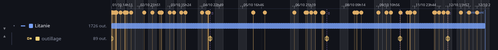

*`819d3fef`, session entière : les instants où le catalogue d'outils change — 89 outils
offerts, 10 changements en onze jours.*

Ce que l'agent a le droit d'appeler, et les instants où cela change : des outils offerts au
démarrage, un serveur MCP qui se branche, des outils remontés en cours de route par une
recherche d'outils, une restriction imposée par un skill, un changement de mode. Des
**marques** et non des barres : ces événements sont rares, et une voie remplie laisserait
croire à une activité continue qui n'existe pas.

**Les permissions proprement dites ne sont presque jamais enregistrées**, et il vaut mieux
le dire que de bâtir une voie vide. Sur l'ensemble des transcrits : **2 enregistrements de
permissions non vides sur 230**, **2 refus d'outil** en tout, et **un seul** changement de
mode dans une seule session sur 106. Ce qui bouge réellement est le catalogue d'outils. La
carte en donne la chronologie et la liste complète.

---

## skills

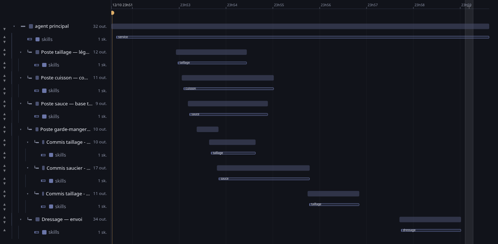

*Kit cuisine, arbre déplié : le chef porte `service` du début à la fin, chaque poste porte
le sien — `taillage`, `cuisson`, `sauce`, `dressage` — sur toute sa vie.*

Une **voie par agent** montre les skills qu'il a chargés : une bande par skill, qui commence
à l'instant du chargement et court jusqu'à la fin de l'agent. La bande n'affirme rien qu'on
n'ait mesuré — elle ne prétend pas qu'un skill « règne » : elle dit que son texte est dans
le contexte du modèle, ce qui reste vrai tant que rien ne le réécrit. Le seul événement qui
le réécrive est un **compactage**, et la bande s'y arrête alors sur une coupe franche, dans
la couleur des compactages.

C'est « **qui fonctionne avec quoi** », sans avoir à le chercher.

**Cliquer une bande ouvre sa carte**, qui répond à ce que l'appel seul ne dit pas :

- **ce qu'il a fait faire** — les appels d'outils passés pendant sa plage, comptés par
  outil ;
- **sa part du contexte** — ses caractères rapportés au texte entier de l'agent au dernier
  appel ;
- **ce qui cohabitait** — les autres skills en contexte en même temps, et les serveurs MCP
  en place ;
- **qui d'autre s'en sert** — le recensement de toute la machine, chargements et sessions,
  lu à la demande ;
- **sa définition entière**, dépliable.

**La définition montrée est celle qui a été chargée, jamais le fichier d'aujourd'hui**, et
ce n'est pas un détail de principe : mesuré sur `taillage`, le texte injecté le 12 octobre
fait 1 237 caractères quand le fichier sur disque en fait 2 961, réécrit le lendemain à
11h26 — au point qu'il **ne contient même plus** ce qui avait été chargé. Lire le disque
montrerait un skill qui n'a jamais tourné.

> **Ce que cette voie a fait découvrir.** Un skill entre de deux façons : comme pièce jointe
> `invoked_skills` — les skills livrés avec Claude Code — ou comme un simple message de
> session, qui est le cas des skills d'un projet. L'application ne lisait que la première, et
> voyait donc **12 chargements sur 58**. Tout le kit cuisine lui était invisible, et les
> 358 288 caractères que ces skills injectent ne pesaient dans aucune bande du Contenu CTX.

**La bande n'a pas de couleur à elle, et c'est mesuré.** La ligne du temps porte déjà seize
teintes ; le balayage de 1 703 teintes conformes n'en trouve aucune dix-septième qui
atteigne la cible de 8 ΔE en vision déficiente — sauf dans la famille ambre, déjà occupée
deux fois. L'identité vient donc du **nom écrit dans la bande**, et la forme de son contour,
à 4,2 : 1 contre le fond, la rend lisible sans éteindre les voies qu'elle recouvre.

---

## hooks

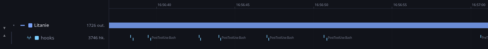

*`819d3fef`, zoom fort : les `PostToolUse:Bash` se nomment. 3 746 hooks sur la session.*

Un trait par hook exécuté. À droite de chaque marque s'écrit le nom de l'événement —
`PostToolUse:Bash`, `SubagentStart:commis-taillage` — en 8 px, à côté des 10 px du nom
d'outil : le hook est un à-côté du geste, pas le geste. Les noms sont longs et les hooks se
suivent de quelques dizaines de millisecondes, si bien que l'étiquette ne sort **qu'à fort
zoom**. C'est voulu : en vue d'ensemble, une voie de 65 marques reste une trame, et c'est en
s'approchant qu'elle se nomme.

La carte donne la commande, le code de sortie, la durée, ce qui a été injecté dans le
contexte, la sortie et l'erreur.

> **Cette étiquette a révélé une chose sur la trace elle-même : elle n'est pas dans l'ordre
> du temps.** Trois des 65 hooks de la session d'exemple reculent — l'un de **110 secondes** —
> parce qu'un `hook_success` s'écrit au moment où l'appel se referme, pas au moment où le hook
> tourne. Tant que la voie ne faisait que poser des marques, le désordre ne se voyait pas.
> Dès qu'il a fallu mesurer la place **jusqu'à la marque suivante**, « la suivante » a cessé
> d'être « celle de droite » : trois étiquettes mordaient leur voisine. La liste est désormais
> triée avant d'être dessinée. Vérifié ensuite à six niveaux de zoom, de 2 à 1 000 px/s :
> **zéro chevauchement**, la marge la plus serrée à 22 px.

---

## fichiers

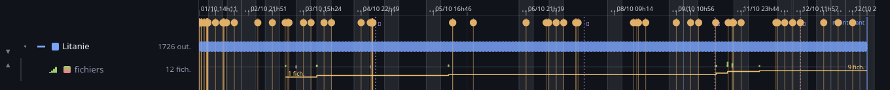

*`819d3fef`, session entière : l'escalier du nombre de fichiers monte de 1 à 9 ; les marques
vertes sont les écritures.*

Chaque opération sur un fichier se lit de part et d'autre d'une ligne de base : **vers le
haut en vert les lignes ajoutées, vers le bas en rose celles retirées**, et un simple trait
sur la ligne pour un fichier seulement lu. Les hauteurs suivent la racine du nombre de
lignes, sans quoi un fichier de mille lignes réduirait une correction de trois lignes à rien.

Sur la session `454ef787` : **162 fichiers distincts**, 179 opérations — 98 lectures,
80 écritures, 1 modification — pour **+12 065 / −2 lignes**. La carte liste les fichiers
les plus repris, ce qui montre où le travail a buté.

**La courbe du nombre de fichiers.** En bas de la même voie court un escalier : le nombre
de fichiers que l'agent a fait exister. Il monte à chaque fichier écrit pour la première
fois, et descend quand l'agent en supprime un qu'il avait écrit. Un escalier et non une
courbe lissée — le compte change par bonds, et lisser laisserait croire à une progression
continue. Le diff et la courbe occupent deux bandes distinctes de la voie : mélangés sur la
même amplitude, ils se rendaient illisibles l'un l'autre.

**Elle ne devine jamais.** Une suppression par motif, par variable ou par substitution est
ignorée, parce qu'on ne saurait pas ce qu'elle efface réellement — la carte compte ces
suppressions non attribuées à part. Mieux vaut une courbe qui en rate que d'en inventer.
Mesuré sur l'ensemble des transcrits : 23 agents ont une courbe, **3 la voient descendre**,
et 131 suppressions restent non attribuées.

> **Sur le « diff git ».** Le transcript n'en contient aucun. Mais il contient mieux : ce que
> l'agent a *demandé*. Un `Edit` porte l'ancien et le nouveau texte, donc le compte est
> exact. Un `Write` ne porte que le nouveau contenu : ses lignes comptent en positif, et ce
> qu'il a remplacé reste inconnu — la carte le dit.

---

## boucles

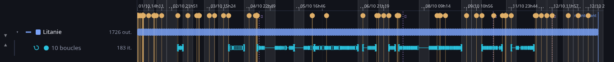

*`819d3fef`, session entière : dix boucles, 183 itérations. La session est faite de boucles
presque de bout en bout.*

Une boucle est une suite de réveils délimitée par un arrêt. Elle n'étant pas un agent, elle
se dessine comme un **rail** et non comme une barre : un trait borné par deux montants
pleins à empattement, qui se lisent comme un début et une fin et ne se confondent pas avec
les encoches d'itération. Chaque encoche est pleine ou creuse selon que le tour a produit
quelque chose.

Deux boucles ne se recouvrent jamais à l'écran : celle qui arrive se pose sur le rang
suivant. Se *toucher* n'est pas se recouvrir — une boucle commence souvent à l'instant exact
où la précédente s'arrête, et cela ne fait pas descendre d'un rang.

**La liste déroulante en haut choisit une boucle** : sa carte s'ouvre et **sa plage est mise
en évidence sur toute la hauteur** de la ligne du temps, avec son nombre d'itérations et sa
durée. Choisir ensuite une case dans la bande d'itérations **encadre ce tour précis**, en
pointillés — sa fenêtre allant de la fin du tour précédent à son propre réveil. Si le tour
n'est pas dans la vue, la ligne du temps s'y transporte ; s'il y est déjà, elle ne bouge
pas, pour ne pas faire sauter l'écran sous les doigts.

Sa carte montre la répétition telle quelle : une case par itération, pleine si quelque chose
a été produit, grise si rien n'a changé. Cliquer une case donne son instant, le délai
demandé pour le réveil suivant, et la raison écrite à ce moment-là. L'en-tête compte les
itérations sans effet, et combien de suite à la fin — le signe d'une boucle qui tourne à
vide.

Sur `819d3fef` : dix boucles, **183 cases**, retrouvées sans en perdre ni en compter deux
fois — 173 relances et les **10 arrêts**, qui ont chacun leur case et leur marque. Sur
`454ef787` : six boucles, 78 cases, dont 6 arrêts.

**Et un réveil programmé n'est pas un réveil survenu.** Sur les 173 relances de `819d3fef`,
le transcript n'enregistre que **146 réveils** (`system/scheduled_task_fire`) : 27 n'ont
jamais eu lieu. Un relevé de ce qui vient après chaque relance en donne le sens — 128 fois
le réveil lui-même, **35 fois la fin d'une tâche d'arrière-plan** qui reprend la main avant
lui, 7 fois Yves, 3 sans rien d'identifiable. Ce relevé est approximatif : il ne retrouve
que 128 des 146 réveils réellement enregistrés, parce qu'il ne regarde que les quarante
lignes suivantes. L'ordre de grandeur, lui, tient.

> ⚠️ **La bande d'itérations ne distingue pas encore les deux.** Une case dit ce que le tour
> a produit, pas si le réveil qu'il a demandé a eu lieu. C'est une réserve connue, pas une
> mesure manquante.

La carte relie aussi les boucles aux agents : chaque itération liste les agents nés pendant
ce tour, de toutes profondeurs, et la carte d'un agent dit réciproquement de quelle
itération il vient. Elle montre enfin le **délai subi** face au délai demandé :
`ScheduleWakeup` dit quand on voudrait être réveillé, `scheduled_task_fire` dit quand on l'a
été. Mesuré sur une itération : 300 s demandés, 272 s subis.

---

## Taille CTX

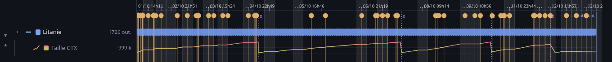

*`819d3fef`, session entière : la dent de scie monte jusqu'à 999 k jetons et retombe à chaque
compactage — les traits verticaux en pointillés.*

La taille du contexte, dessinée **en courbe simple** — une grandeur qui monte et descend
n'est pas une quantité accumulée, et la remplir donnait à l'œil une masse qui ne voulait
rien dire. Trois repères très pâles marquent le **0, la moitié et le plafond** : sans
graduation, une courbe ne dit que « ça monte et ça descend » ; avec, on lit sa hauteur d'un
coup d'œil. Le trait porte un dégradé vertical du vert au rouge — la hauteur décide de la
couleur, donc une fenêtre qui sature rougit.

> ⚠️ **Et le dégradé dit enfin ce qu'il prétend.** Tant qu'il peignait une aire, il
> s'étirait sur la boîte de ce polygone, pas sur la hauteur de la voie : une courbe qui ne
> montait qu'à mi-hauteur rougissait quand même à son sommet. Il est désormais tracé en
> coordonnées de la voie (`gradientUnits="userSpaceOnUse"`, du bas au haut de la voie),
> avec un dégradé par voie.

Elle se lit dans `message.usage` : entrée + lecture de cache + création de cache. Le
`total_tokens_reminder` du transcript, lui, est un budget de jetons et non la fenêtre : il
ne répond pas à la question.

Les compactages sont des repères verticaux en pointillés. Sur `454ef787`, le contexte monte
à **996 455 jetons**, un compactage survient, il retombe à **52 151** : la dent de scie est
franche, et c'est le fait le moins intuitif du fonctionnement d'un agent.

Les pannes d'API — messages de modèle `<synthetic>` portant `API Error: …` — ont leur repère
et sont comptées sur la carte de l'agent.

---

## Contenu CTX

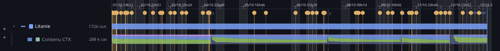

*`819d3fef`, session entière : les parts du contexte, empilées sur toute la hauteur.*

À chaque appel au modèle, **de quoi le contexte était fait** — en parts empilées sur toute
la hauteur, puisque la taille est déjà donnée par la voie du dessus : invite système et
rappels, résultats d'outils, appels d'outils, paroles du modèle, requêtes d'Yves. Cliquer un
appel en donne la recette chiffrée.

**On peut lire le contexte lui-même.** Les trois cartes qui parlent d'**un** appel au
modèle — *Contenu CTX*, *Buffer CTX* et celle d'un appel au modèle — portent un bloc « lire
le contexte envoyé à cet appel » : il va chercher au serveur, à la demande, la suite exacte
des éléments qui composaient le contexte à cet instant — le résumé du dernier compactage,
les skills chargés, chaque appel d'outil avec sa commande, chaque résultat avec son
contenu, les rappels, les paroles du modèle. Chaque élément se déplie, et des filtres par
genre permettent de ne garder que ce qu'on cherche. La façon dont cette liste se découpe en
gestes et en moments est décrite dans
[les cartes](3-se-servir-de-l-application.md#le-contexte-raconte-une-histoire-et-elle-se-lit).

C'est servi **à la demande parce que c'est gros** : 623 ko en 0,4 s pour un contexte de
428 éléments et 568 439 caractères, sur le plus gros transcript de la machine. Le mettre
dans la page coûterait ce poids à chaque rafraîchissement, pour quelque chose qu'on ne
regarde qu'un appel à la fois.

**Deux choses manquent, et l'application le dit plutôt que de les passer sous silence.**
L'invite système complète, les définitions d'outils et la mémoire du projet ne sont pas
dans le transcript. Et **le contenu des blocs de réflexion n'est pas conservé** : le
transcript n'en garde que la signature. Ces blocs apparaissent quand même dans la liste,
marqués « contenu non conservé », pour qu'on sache qu'ils occupaient de la place.

**Ce que cette voie ne peut donc pas montrer, et le dit.** Mesuré sur `819d3fef` :
**1,37 caractère attribué par jeton de contexte**, là où du texte ordinaire en compte
environ quatre — le transcript ne nomme donc qu'**un tiers environ** du contexte. La carte
porte une jauge qui donne cette part, appel par appel.

> Un piège évité en chemin : compter les pièces jointes en entier donnait 85 % de
> « système », parce qu'un enregistrement `hook_success` recopie la commande du hook —
> douze millions de caractères sur cette seule session, qui ne sont jamais envoyés au
> modèle. Seuls les champs réellement injectés sont comptés.

---

## Buffer CTX

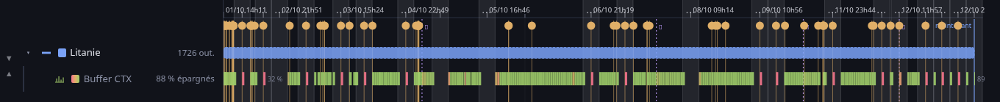

*`819d3fef`, session entière : 88 % épargnés. Les stries rouges sont les reprises après une
pause, où le cache a expiré.*

Une bande par appel au modèle, du rouge au vert selon ce que le cache **épargne** sur cet
appel.

**Pourquoi l'économie plutôt que la part relue.** La part relue ne distingue rien : mesurée
sur **16 178 requêtes** de cette machine, elle vaut 97,9 % en moyenne et 96 % des appels
sont au-dessus de 90 %. Une échelle fondée dessus peindrait tout en vert. On montre donc ce
que l'appel ne paie pas, aux tarifs relatifs d'Anthropic — écrire au cache coûte 1,25 fois
le prix plein, y lire 0,1 fois :

```
économie = 1 − (prix fort + 1,25 × écrits au cache + 0,1 × lus du cache) / entrée totale
```

**Le dégradé est tendu de 50 % à 90 %, pas de 0 à 100 %.** 90 % est le plafond : même
entièrement relu, un contexte coûte encore un dixième. 50 % est le premier centile mesuré
(52,4 %), ce qui fait saturer en rouge le pour-cent d'appels les plus coûteux au lieu
d'écraser l'échelle. Entre les deux, les percentiles mesurés se répartissent — p5 à 80,6 %,
p25 à 88,4 %, médiane à 89,4 %, minimum absolu **−25 %** quand tout est réécrit au cache.

**Le pourcentage est écrit à côté de la marque** dès qu'il y a la place, selon la même règle
que le nom d'un outil — vérifié à trois niveaux de zoom, zéro chevauchement par voie.

**La voie est verte presque partout, et c'est la vérité** : seuls 2,1 % des appels tombent
sous 70 %. Son travail est de montrer ces exceptions-là, pas de noircir un tableau qui va
bien.

**Ce que disent les stries rouges.** Elles ne sont pas des fautes de conduite : ce sont des
reprises après une pause, où le cache a expiré. Mesuré sur la session la plus longue,
2 880 appels : des **22 appels sous 70 %, 18 suivent un silence de plus de cinq minutes**,
l'écart médian étant de 2 h 36 — contre 2,3 s pour les 2 857 autres. Le premier appel d'un
agent est rouge pour la même raison, en pire : il n'y a rien à relire.

**Une marque par appel, et sa largeur est plafonnée.** Jusqu'au 15 octobre 2026, chaque
appel peignait une bande qui tenait jusqu'au suivant. L'intention était juste — l'état du
buffer ne change que quand on y touche — mais la largeur se mettait alors à mesurer **le
temps d'attente**, qui ne dit rien du cache. Mesuré sur la session de 2 880 appels :

| | bande continue | marque plafonnée |
|---|---|---|
| éléments dessinés | 434 (fusionnés) | **2 880**, un par appel |
| la plus large, à elle seule | 3,1 % de la voie | **0,10 %** |
| les dix plus larges | 20,1 % | **1 %** |
| la moitié la plus fine | 22,2 % | **48 %** |
| les mêmes, repli des temps morts décoché | **56 % pour un seul appel** | identique au cas replié |

La dernière ligne est la preuve : la voie ne dépend plus du temps d'attente. Et comme plus
rien n'est fusionné, **chaque appel est maintenant cliquable** là où 2 880 appels se
réduisaient à 434 bandes.

> ⚠️ **Et le chiffre de la voie n'est pas celui de la carte d'un appel.** La voie montre
> l'**économie** — ce que l'appel ne paie pas, aux tarifs relatifs. La carte d'un appel au
> modèle montre la **part relue**, qui est un autre nombre : sur un appel mesuré, 77 234
> jetons présentés dont 74 130 relus, cela fait **96 % de part relue** et **85 % d'économie**.
> Les deux sont justes. La ligne de la voie dit donc « 85 % épargnés », et non « 85 % ».

**Ce qu'on ne sait pas dire.** Les tarifs sont des rapports, pas une monnaie : l'économie
est exacte en proportion et muette en euros, parce que le transcript ne porte aucun prix.

---

[Suivant : la suite →](5-la-suite.md)
